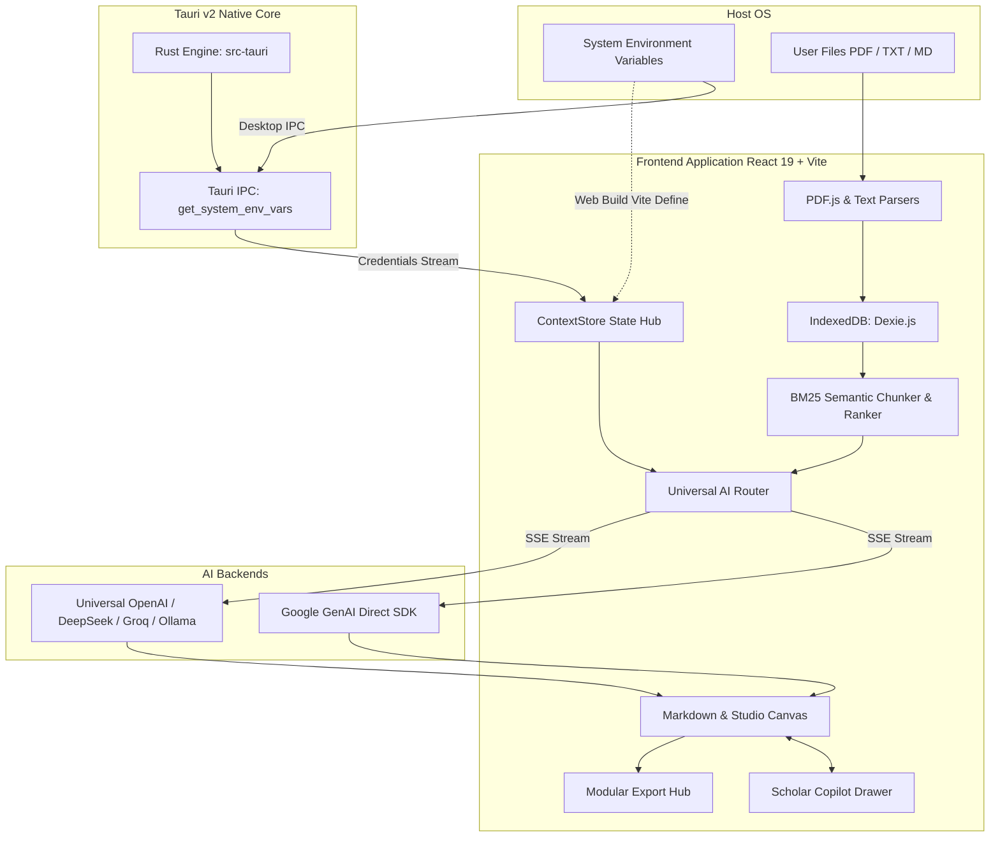

# TomGee's Scholar Studio — Technical Architecture & Engineering Specifications

This document outlines the engineering architecture, data flows, and design decisions behind **TomGee's Scholar Studio**.

---

## 1. High-Level Architectural Overview

Scholar Studio is engineered as an offline-first Single Page Application (SPA) packaged for both modern browsers and native Windows desktop execution via **Tauri v2**.



---

## 2. Desktop Packaging (Tauri v2) & Rust IPC Bridge

In desktop mode, the application runs inside a lightweight Webview2 window powered by Tauri v2:

- **Manifest:** `src-tauri/Cargo.toml` (`tomgees_scholar_studio`, edition 2024, Rust 1.99.0).
- **Configuration:** `src-tauri/tauri.conf.json`
  - Dimensions: 1300x860, min 960x600.
  - Distribution: Frontend packaged statically from `../dist`.
- **Host IPC Command (`src-tauri/src/lib.rs`):**
  ```rust
  #[tauri::command]
  fn get_system_env_vars() -> HashMap<String, String> {
      let mut vars = HashMap::new();
      for (k, v) in std::env::vars() {
          if k.ends_with("_API_KEY")
              || k.ends_with("_KEY")
              || k.contains("OLLAMA")
              || k.contains("GEMINI")
              || k.contains("DEEPSEEK")
              || k.contains("OPENROUTER")
              || k.contains("GROQ")
              || k.contains("OPENAI")
          {
              vars.insert(k, v);
          }
      }
      vars
  }
  ```
- **Frontend Interop:** Invoked dynamically via `@tauri-apps/api/core` (`isTauri()` guard) inside `ContextStore.tsx` to read the host operating system environment without hardcoding or browser local storage exposures.

---

## 3. Storage Architecture (Dexie IndexedDB)

All persistent application data is managed via Dexie.js inside the browser's IndexedDB engine:

- **Database Name:** `TomGeesScholarDB`
- **Current Version:** `4`
- **Schema Stores:**
  - `documents`: `id, name, type, timestamp, enabled` (Full document text and metadata)
  - `drafts`: `id, mode, timestamp, provider, model` (Full versioned history of study suites)
  - `chunks`: `id, documentId, docName, chunkIndex` (Pre-split semantic chunks for BM25 retrieval)
  - `chatMessages`: `id, conversationId, role, timestamp` (Multi-turn dialogue history for Scholar Copilot)

---

## 4. Token Efficiency & Client-Side BM25 RAG

To handle massive reference corpuses while preventing context window blowouts, Scholar Studio implements a dual-tier adaptive context injection engine:

### A. Semantic Chunking
Document text is divided into chunks using a sliding window algorithm:
- **Chunk Size:** ~400 words
- **Overlap:** 50 words to preserve inter-sentence semantic continuity
- **Index:** Stored in `db.chunks` immediately upon document upload

### B. BM25 Relevance Scoring
When context retrieval is triggered:
```typescript
Score(D, Q) = ∑ IDF(q) * [ (f(q, D) * (k1 + 1)) / (f(q, D) + k1 * (1 - b + b * (|D| / avgdl))) ]
```
Where:
- `k1 = 1.2` (term frequency saturation)
- `b = 0.75` (document length normalization)
- Top-15 chunks are ranked, extracted, and injected into the system prompt with explicit source labels.

---

## 5. Universal AI Routing & Dynamic Model Discovery

### A. OpenAI-Compatible Hub (`openAICompatibleProvider.ts`)
- Implements standard Server-Sent Events (SSE) streaming over any OpenAI `/v1/chat/completions` endpoint.
- Handles exponential backoff on HTTP 429 rate limit responses.
- Supports dynamic querying of `/v1/models` to discover active model lineups on DeepSeek, Groq, OpenRouter, and Ollama.

### B. Google GenAI Direct SDK (`geminiProvider.ts`)
- Powered by official `@google/genai`.
- Dynamically queries available models via `ai.models.list()`.
- Supports both single-turn prompt execution and multi-turn conversational histories (`contentsPayload` mapping).

---

## 6. Bundle Optimization & Code Splitting

To ensure sub-second startup times and eliminate large bundle warnings, `vite.config.ts` partitions vendor packages into distinct chunks:

| Chunk Name | Modules Included | Typical Gzip Size |
| :--- | :--- | :--- |
| `pdfjs-vendor` | `pdfjs-dist` | ~144 kB |
| `gemini-vendor` | `@google/genai` | ~71 kB |
| `markdown-vendor` | `react-markdown`, `remark-gfm`, `rehype-highlight` | ~104 kB |
| `storage-vendor` | `dexie` | ~32 kB |
| `icons-vendor` | `lucide-react` | ~7 kB |
| `index` | Core Application Logic & Components | ~93 kB |

---

## 7. Quality Gates & Continuous Integration

Every commit is validated against four strict automated gates in `.github/workflows/ci.yml` across both Ubuntu and Windows:
1. `npx tsc --noEmit` — Strict TypeScript typecheck (`strict: true`, zero implicit any).
2. `npx eslint .` — ESLint 9 Flat Config static analysis.
3. `npx vitest run` — Automated unit test suite covering token calculations, BM25 scoring, export parsing, and AI routing.
4. `npm run build` — Clean production bundle build with zero chunk warnings.
